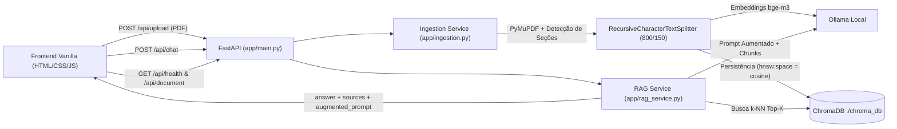

# RAG Editais — Consulta Vetorial de Editais de Concursos Públicos

Aplicação web local de **RAG (Retrieval-Augmented Generation)** desenvolvida para a disciplina de **Bancos de Dados Não Convencionais**, demonstrando na prática a ingestão de documentos PDF com metadados estruturais, geração de embeddings densos locais, armazenamento em banco vetorial (**ChromaDB**), busca **k-NN por similaridade de cosseno** e geração fundamentada (*grounded*) via **Ollama**.

---

## Arquitetura Vetorial



### Conceitos de Bancos de Dados Não Convencionais Demonstrados

1. **Chunking com Enriquecimento Contextual:** O `PyMuPDF` extrai o texto página a página, ignora linhas de sumário com pontilhado (`....`) e identifica títulos e seções típicas de editais (`1. DAS DISPOSIÇÕES PRELIMINARES`, `CAPÍTULO`, `ANEXO`), propagando `source`, `page`, `section`, `chunk_index` e `document_id` e prefixando `[Seção | Página]` no texto indexado para enriquecer os embeddings.
2. **Representação Vetorial Densa (`bge-m3`):** Tanto os chunks do edital quanto a pergunta do usuário são convertidos em vetores densos localmente pelo modelo `bge-m3` via Ollama.
3. **Banco Vetorial & Busca Híbrida (Cosseno + BM25 RRF):** Os vetores e metadados são persistidos no **ChromaDB** (`./chroma_db`) com `collection_metadata={"hnsw:space": "cosine"}`. Na consulta, o sistema suporta **Busca Híbrida** combinando o ranking semântico denso (Cosseno k-NN) com o ranking léxico (**BM25** normalizado em português) via **Reciprocal Rank Fusion (RRF)**, além do modo **Vetorial Pura** para comparação acadêmica.
4. **RAG Grounded, Streaming SSE & Transparência:** Os tokens do LLM (`qwen2.5:3b` ou outro modelo instalado no Ollama selecionado na interface) são transmitidos em tempo real via **Server-Sent Events** (`POST /api/chat/stream`), exibindo telemetria de latência (`retrieval_ms` / `generation_ms`), scores individuais (`cos` e `bm25`) e modal para inspecionar o **prompt aumentado** completo.

---

## Estrutura do Projeto

```text
rag-editais/
├── app/
│   ├── __init__.py
│   ├── config.py          # Configurações via Pydantic Settings (.env)
│   ├── ingestion.py       # Extração PyMuPDF, detecção de seções, chunking e ChromaDB
│   ├── rag_service.py     # Busca k-NN, prompt aumentado e chamada ChatOllama
│   └── main.py            # Rotas FastAPI e servidor de arquivos estáticos
├── static/
│   ├── index.html         # Interface web (upload, chat, painel k-NN e modal do prompt)
│   ├── style.css          # Estilização responsiva
│   └── app.js             # Consumo das APIs via Fetch API
├── tests/
│   ├── test_ingestion.py  # Testes unitários de extração, chunking e ChromaDB
│   └── test_api.py        # Testes dos endpoints FastAPI com mocks
├── .env.example
├── pyproject.toml
├── requirements.txt
└── README.md
```

---

## Como Executar Localmente

### Pré-requisitos
- **Python 3.11+**
- **Ollama** instalado e em execução ([ollama.com](https://ollama.com))

### 1. Baixar os modelos no Ollama

```powershell
ollama pull bge-m3
ollama pull qwen2.5:3b
```

### 2. Configurar o ambiente Python (Windows PowerShell)

```powershell
cd rag-editais
python -m venv .venv
.\.venv\Scripts\Activate.ps1
pip install -r requirements.txt
Copy-Item .env.example .env
```

*(Em Linux/macOS, ative com `source .venv/bin/activate` e copie com `cp .env.example .env`.)*

### 3. Iniciar a aplicação

```powershell
uvicorn app.main:app --reload
```

Acesse no navegador: **`http://127.0.0.1:8000`**

---

## Endpoints da API

| Método | Rota | Descrição |
| :--- | :--- | :--- |
| `GET` | `/api/health` | Verifica se o Ollama está acessível e se `EMBEDDING_MODEL` e `LLM_MODEL` estão disponíveis |
| `GET` | `/api/document` | Retorna o resumo do edital atualmente indexado no ChromaDB (ou `null`) |
| `POST` | `/api/upload` | Recebe `.pdf` via `multipart/form-data`, extrai seções, gera chunks e indexa no ChromaDB |
| `POST` | `/api/chat` | Recebe `{ "question", "top_k", "search_mode", "model" }`, executa busca vetorial/híbrida e retorna `{ answer, sources, augmented_prompt, metrics }` |
| `POST` | `/api/chat/stream` | Versão em tempo real via **Server-Sent Events (SSE)** transmitindo `sources`, `token` e `done` |

---

## Testes Automatizados & E2E (Playwright)

Os testes unitários e de integração validam o pipeline de extração/chunking/re-ingestão no ChromaDB e todos os endpoints da API (usando mocks determinísticos para o Ollama):

```powershell
.\.venv\Scripts\pytest.exe -v
```

Para rodar também a verificação ponta a ponta (E2E) com navegador Chromium real contra o servidor Uvicorn + Ollama:

```powershell
pip install -r requirements-dev.txt
.\.venv\Scripts\playwright.exe install chromium
.\.venv\Scripts\python.exe tests\e2e_playwright_verify.py
```

---

## Licença

Este projeto está licenciado sob a [Licença MIT](LICENSE).
